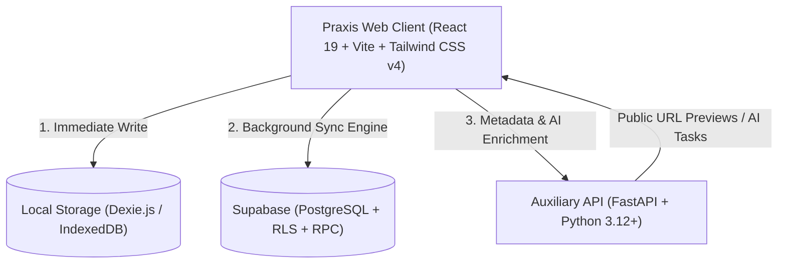

<div align="center">

# 📑 Praxis — Calm, Local-First Personal Memory & Planner

**Capture thoughts, tasks, resources, and calendar events before you forget them.**  
*A minimal, distraction-free productivity app built with a local-first architecture, offline resilience, and cloud synchronization.*

<br />

[](https://praxis-app.vercel.app)

<br />

[](https://react.dev/)
[](https://vitejs.dev/)
[](https://tailwindcss.com/)
[](https://fastapi.tiangolo.com/)
[](https://python.org)
[](https://supabase.com/)
[](https://dexie.org/)

<br />

[Live Demo](#-live-demo) · [Overview](#-overview) · [Screenshots](#-screenshots) · [Features](#-features) · [Architecture](#-architecture) · [Getting Started](#-getting-started) · [API Reference](#-api-reference) · [Verification](#-verification--testing)

</div>

---

## 📖 Overview

**Praxis** is a full-stack, local-first productivity application and personal memory system designed to turn raw, fleeting thoughts into structured, actionable items. Upload or type an idea, link, or reminder into the global Quick Capture bar—Praxis instantly commits it to your local browser storage (**IndexedDB** via **Dexie.js**), guaranteeing that zero thought is ever lost even when offline.

When connectivity is available, an intelligent bidirectional synchronization engine reconciles local changes with **Supabase PostgreSQL** through atomic RPC transactions and Row Level Security (RLS). A dedicated auxiliary **FastAPI** backend enriches links with OpenGraph metadata, extracts previews, and provides background AI analysis.

---

## 📸 Screenshots

<div align="center">
  <table>
    <tr>
      <td align="center"><b>Dark Mode (Desktop)</b></td>
      <td align="center"><b>Light Mode (Desktop)</b></td>
    </tr>
    <tr>
      <td></td>
      <td></td>
    </tr>
    <tr>
      <td colspan="2" align="center"><b>Mobile First & Responsive Layout</b></td>
    </tr>
    <tr>
      <td colspan="2" align="center">
        
      </td>
    </tr>
  </table>
</div>

---

## ✨ Features

- **⚡ Instant Quick Capture**: Capture plain text, Markdown notes, task checklists, or URLs with a comfortable hotkey workflow (`Enter` to submit, immediate local commit).
- **📥 Triage Inbox & Classification**: Organize incoming items into specialized types:
  - **Notes / Ideas**: Long-form thoughts and drafts with real-time autosave.
  - **Tasks**: Due dates, priorities (`low`, `normal`, `high`), and completion states.
  - **Resources**: URL tracking, reading status (`unread`, `reading`, `completed`), and metadata previews.
  - **Events**: Start/end timestamps, all-day toggles, and calendar scheduling.
- **📅 Daily To-Do Planner & Weekly Productivity Dashboard**: Plan daily objectives, carry forward overdue items with a single tap, track 7-day completion rates, and review bar chart productivity analytics.
- **🗓️ Responsive Calendar**: Full month grid with intuitive day agendas, event dots on compact mobile viewports, and non-blocking scheduling modals.
- **📶 Local-First & 100% Offline Capable**: Full reading and capture support without an active internet connection. Unsynchronized changes queue automatically in a local outbox and sync upon reconnection.
- **🔐 Enterprise Security & Data Isolation**: User authentication powered by Supabase (Email/Password & Google OAuth) with strict PostgreSQL Row Level Security (RLS) policies.
- **💾 Data Portability**: One-click complete JSON backup export (Schema v1.0.0) containing all active items, notes, tasks, resources, events, and soft-deleted records.
- **📱 Fully Responsive**: Thoughtfully tuned for viewports from 320px smartphones to ultra-wide displays with safe-area insets, thumb-friendly navigation capsules, and zero horizontal overflow.

---

## 🏗️ Architecture



### Repository Structure

- **`web/`**: Client-first Single Page Application built with React 19, TypeScript, Tailwind CSS v4, Lucide icons, and Dexie.js.
- **`api/`**: Auxiliary FastAPI backend deployed on Render for URL parsing, metadata extraction, and AI processing.
- **`supabase/`**: PostgreSQL database migrations, idempotent classification RPC functions, and Row Level Security.
- **`docs/`**: Architecture decision records (ADRs), product specifications, design tokens, and technical documentation.

---

## 🚀 Getting Started

### Prerequisites

- **Node.js**: v22+ (Active LTS)
- **npm**: v10+
- **Python**: 3.12+ / 3.14+
- **Supabase Account**: (or local Supabase CLI instance)

---

### 1. Web Application (`web/`)

```bash
# Navigate to web directory
cd web

# Install dependencies
npm install

# Configure environment variables
cp .env.example .env
# Edit .env with your VITE_SUPABASE_URL and VITE_SUPABASE_ANON_KEY

# Start local development server
npm run dev
```

The web client runs at `http://localhost:5173`.

---

### 2. Backend API (`api/`)

```bash
# Navigate to backend directory
cd api

# Install dependencies and start FastAPI server
pip install -r requirements.txt
uvicorn src.personal_memory_api.main:app --reload --port 8000
```

The API runs at `http://localhost:8000` with interactive OpenAPI docs at `http://localhost:8000/docs`.

---

### 3. Database Migrations (`supabase/`)

Apply database migrations to your Supabase project in sequential order:

1. `supabase/migrations/20261008000000_initial_schema.sql` — Base tables, items, tasks, resources, and RLS policies.
2. `supabase/migrations/20261009000000_classify_item_rpc.sql` — Atomic item classification RPC.
3. `supabase/migrations/20261010000000_classify_item_rpc_idempotent.sql` — Idempotent transactional extensions.
4. `supabase/migrations/20261012000000_tasks_completed_idx.sql` — Performance index for daily and weekly planner queries.

---

## 📡 API Reference

| Method | Endpoint | Description |
| :--- | :--- | :--- |
| `GET` | `/health` | Healthcheck and service readiness status |
| `POST` | `/api/v1/enrich` | Extract OpenGraph metadata, title, and favicon from a URL |
| `POST` | `/api/v1/classify` | AI advisory classification and summarization for captured text |

---

## 🧪 Verification & Testing

Praxis includes comprehensive automated testing covering unit, integration, and responsive behavior:

```bash
# Run complete frontend test suite (197 tests across 29 suites)
npm --prefix web test

# Run TypeScript typecheck (zero errors)
npm --prefix web run typecheck

# Run linter
npm --prefix web run lint

# Production bundle build
npm --prefix web run build

# Run backend API test suite
pytest api/tests/
```

---

## 📄 License

This project is licensed under the [MIT License](LICENSE).
