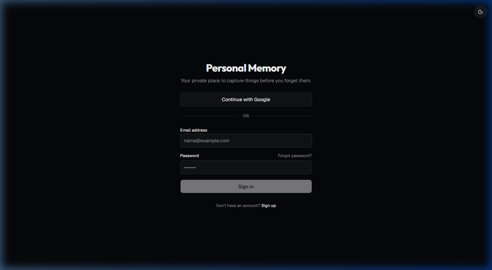
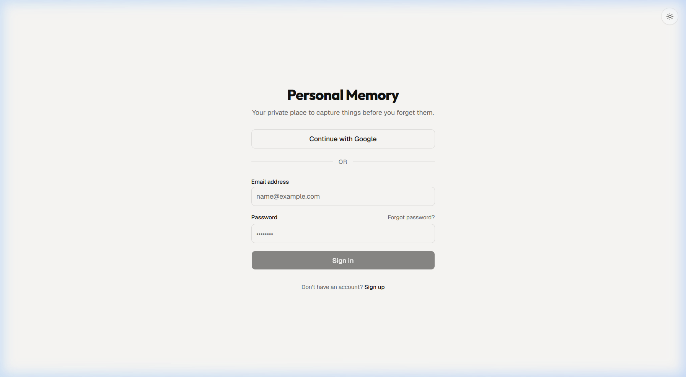
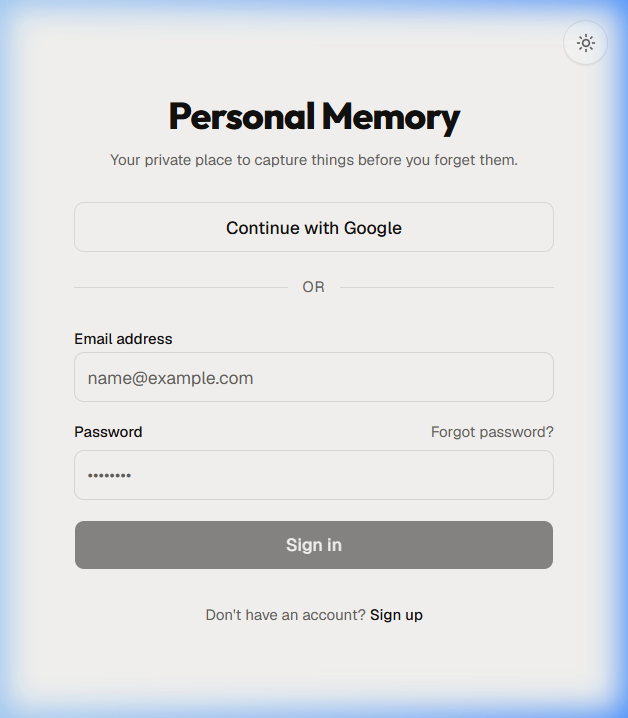
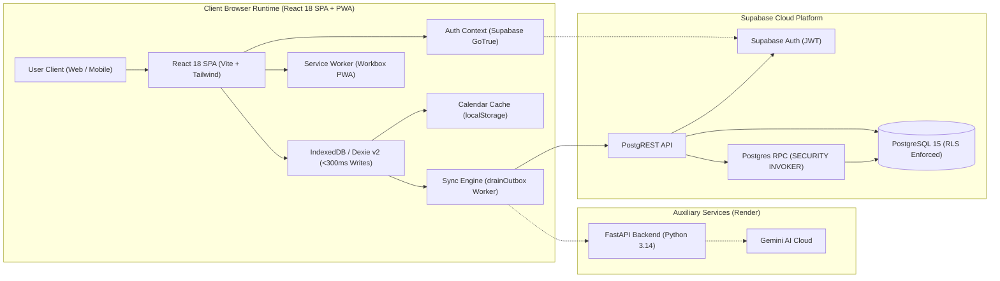

<div align="center">

# 📑 Praxis

### Calm, Local-First Personal Memory & Intelligent Planner

**Capture fleeting thoughts, tasks, resources, and events before you forget them.**  
*Engineered with a local-first offline architecture, sub-300ms write guarantees, strict multi-account isolation, and cloud synchronization.*

<br />

[](https://praxis-app.vercel.app)
[](https://render.com)

<br />

[](https://www.typescriptlang.org)
[](https://react.dev/)
[](https://vitejs.dev/)
[](https://tailwindcss.com/)
[](https://dexie.org/)
[](https://supabase.com/)
[](https://fastapi.tiangolo.com/)


<br />


</div>

---

## 🌟 Overview

**Praxis** is an offline-first personal memory and planning system designed around the principles of **calm computing**. Traditional productivity tools demand categorizing and configuring items the moment inspiration strikes, introducing friction and distraction. Praxis solves this with a two-phase cognitive workflow:

1. **Instant Capture Phase**: Type or paste any idea, task, bookmark, or appointment into the omnipresent capture bar. It is immediately committed to local browser storage (**IndexedDB** via **Dexie.js v2**) in **under 300ms**, with zero network dependency.
2. **Intentional Triage Phase**: Process items when you have focus. Classify captures into long-form **Notes**, prioritized **Tasks**, structured **Resources**, or scheduled **Events** using atomic database transactions.

When network connectivity is detected, an intelligent background sync engine pushes pending mutations to **Supabase PostgreSQL** under strict Row-Level Security (RLS). A companion **FastAPI** service enriches resources with metadata, executes link previews, and powers AI classification hooks.

---

## 📸 Interface Gallery

<div align="center">
  <table>
    <tr>
      <td align="center"><b>🌙 Dark Mode (Desktop)</b></td>
      <td align="center"><b>☀️ Light Mode (Desktop)</b></td>
    </tr>
    <tr>
      <td></td>
      <td></td>
    </tr>
    <tr>
      <td colspan="2" align="center"><b>📱 Mobile-First Responsive PWA Experience</b></td>
    </tr>
    <tr>
      <td colspan="2" align="center">
        
      </td>
    </tr>
  </table>
</div>

---

## ✨ Key Features

### ⚡ 1. Sub-300ms Omni-Capture
- **Instant Local Commit**: Immediate keyboard submission (`Enter`) guarantees that raw thoughts are never lost to latency or connectivity drops.
- **Deterministic Heuristic Tagging**: Local regex classifiers pre-tag URLs, tasks, and ideas on device without waiting for server responses.
- **Provenance Preservation**: Retains immutable `raw_input` alongside structured fields for complete auditability ([ADR-006](docs/adrs/adr-006-immutable-raw-input-provenance.md)).

### 📥 2. Inbox Triage & Relational Extensions
- **Multi-Type Classification**: Dynamically switch items between **Note**, **Task**, **Resource**, and **Event** with tailored extension schemas ([ADR-009](docs/adrs/adr-009-relational-extension-tables.md)).
- **Atomic PostgreSQL RPC**: Type conversions execute inside an atomic database stored procedure (`classify_and_update_item`) to eliminate orphaned state.
- **Soft Deletion & Tombstones**: Non-destructive deletion model synchronized cleanly across online and offline states.

### 📅 3. Daily Planner & Productivity Analytics
- **Daily Focus Agenda**: Schedule tasks by due date with one-tap completion checkboxes and priority badges (`low`, `normal`, `high`).
- **Overdue Task Rollover**: Carry forward yesterday's incomplete tasks with a single click.
- **Weekly Productivity Dashboard**: 7-day visual bar charts displaying completed vs. planned ratios and completion rate percentages.

### 🗓️ 4. Calendar & Timezone Handling
- **Full Month & Day Agendas**: Interactive calendar view with date navigation, event dots on compact displays, and quick modal scheduling.
- **Timezone Normalization**: All event timestamps store UTC ISO strings while rendering accurately in the user's localized timezone.
- **User-Partitioned Cache**: Scoped `localStorage` caching ensures calendar events remain accessible offline without cross-account contamination.

### 📶 5. Offline-First Resilience & Sync Engine
- **Independent Local Operations**: Read, capture, delete, and browse without an internet connection.
- **Automatic Outbox Queue**: Pending mutations queue locally in Dexie with exponential backoff retry algorithms.
- **Account Transition Guards**: The sync engine validates ownership before every mutation and aborts mid-sync if the active user changes.

### 🔐 6. Enterprise-Grade Security & Isolation (SEC-001)
- **Supabase Authentication**: Secure session management via Email/Password (with visibility toggle) and Google OAuth.
- **Database Row-Level Security (RLS)**: Enforces `USING (user_id = auth.uid())` across all core and extension tables.
- **Zero Cross-Account Leakage**: Dexie schema v2 compound indexes (`[user_id+status]`, `[user_id+deleted_at]`) guarantee complete client-side data isolation on shared browser profiles.

### 💾 7. Data Ownership & Portability
- **Complete JSON Backup**: One-click complete export (Schema v1.0.0) containing all items, notes, tasks, resources, events, and outbox logs.

---

## 🏗️ Architecture & Data Flow




---

## 🔒 Security & Multi-Account Isolation (SEC-001)

Praxis has undergone a comprehensive independent security audit to eliminate cross-account data leakage on shared browser profiles:

- **Compound Index Scoping**: Dexie schema upgraded to version 2 with compound indexes `[user_id+deleted_at]` on `local_items` and `[user_id+status]` on `outbox`.
- **Zero Storage Wipes**: Client IndexedDB data is never wiped on logout. User A's un-synced offline records remain safely stored and isolated while User B is logged in.
- **Mid-Drain Account Switch Abort**: `drainOutbox` re-validates the active Supabase JWT before every remote mutation. If an account switch occurs during an ongoing sync drain, the loop terminates immediately.
- **Partitioned Local Storage**: Calendar cache uses per-user keys (`pm_cached_calendar_events_${userId}`), preventing stale event leaks.
- **Unresolved Session Guards**: Unauthenticated or initializing sessions (`userId === undefined`) strictly return empty sets, eliminating data flashes during session hydration.

Read the complete incident audit and resolution report at [`docs/security/cross-account-data-leakage.md`](docs/security/cross-account-data-leakage.md).

---

## 🚀 Getting Started

### Prerequisites

- **Node.js**: `v20.x` or `v22.x` (Active LTS)
- **npm**: `v10+`
- **Python**: `3.12+` or `3.14+`
- **Supabase Account**: (Cloud instance or local Supabase CLI)

---

### 1. Web Application (`web/`)

```bash
# Navigate to web directory
cd web

# Install dependencies
npm install

# Configure environment variables
cp .env.example .env
# Set VITE_SUPABASE_URL and VITE_SUPABASE_ANON_KEY in .env

# Start local Vite development server
npm run dev
```

The web client runs locally at `http://localhost:5173`.

---

### 2. Marketing Landing Page (`landing/`)

```bash
# Navigate to landing page directory
cd landing

# Install dependencies
npm install

# Start local Vite development server
npm run dev

# Or build and preview production bundle
npm run build
npm run preview
```

The landing page runs locally at `http://localhost:5174`.

---

### 3. Backend API (`api/`)

```bash
# Navigate to API directory
cd api

# Create virtual environment and install dependencies
python -m venv .venv
source .venv/bin/activate  # On Windows: .venv\Scripts\activate
pip install -r requirements.txt

# Start FastAPI server
uvicorn src.personal_memory_api.main:app --reload --port 8000
```

The API runs locally at `http://localhost:8000` with interactive Swagger docs at `http://localhost:8000/docs`.

---

### Automated Test Matrix

| Test Suite | Environment | Coverage | Status |
|---|---|---|---|
| **Frontend Unit & Integration** | Vitest / jsdom | 30 files, 210 tests | **Passed (100%)** |
| **Cross-Account Isolation (SEC-001)** | Vitest / fake-indexeddb | 13 test scenarios | **Passed (100%)** |
| **Backend & RLS Validation** | pytest / anyio | 8 tests | **Passed (100%)** |
| **Static Type Checking** | TypeScript Compiler (`tsc -b`) | Whole codebase | **0 Errors** |
| **Linter Compliance** | oxlint | 93 files | **0 Errors** |
| **Production Build** | Vite + Workbox PWA | 57 precache assets | **Passed (1.09s)** |

---

## 📂 Repository Layout

```text
praxis/
├── api/             # Auxiliary FastAPI microservice (Render deployment)
├── docs/            # Architecture decision records, PRD, design tokens, security audits
├── landing/         # Marketing landing page (React 19, Vite, editorial design system)
├── supabase/        # PostgreSQL schema migrations, RLS policies, stored procedures
└── web/             # React 18 SPA (Vite, Tailwind CSS, Dexie v2, PWA)
```

For the comprehensive directory layout, see [`docs/project-structure.md`](docs/project-structure.md).

---

## 📄 License

This project is licensed under the [MIT License](LICENSE).
