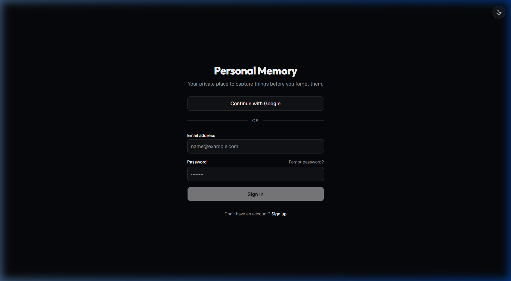
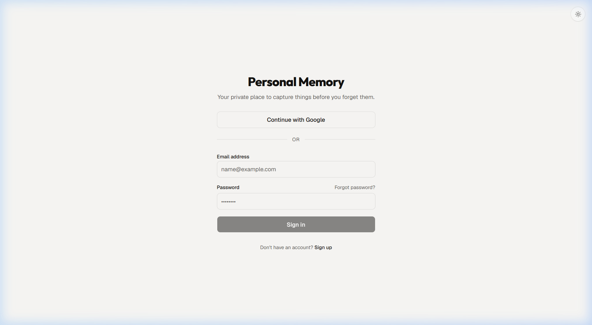
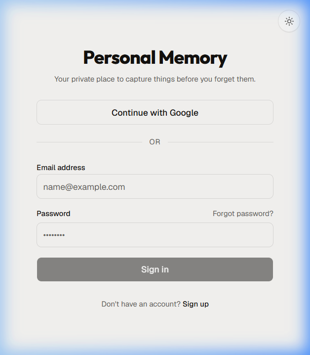
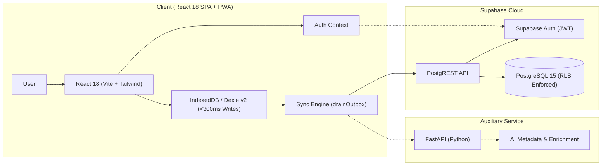

<div align="center">

# 📑 Praxis

### Calm, Local-First Personal Memory & Intelligent Planner

**Capture fleeting thoughts, tasks, notes, and events before you lose focus.**  
*Built with an offline-first architecture, sub-300ms local writes, and secure cloud synchronization.*

<br />

[](https://praxis-memo.vercel.app/)
[](https://www.typescriptlang.org)
[](https://react.dev/)
[](https://tailwindcss.com/)
[](https://supabase.com/)
[](https://fastapi.tiangolo.com/)

</div>

---

## Overview

**Praxis** is an offline-first personal workspace designed for calm productivity. Capture items instantly without cognitive friction, then organize and triage them when you have focus.

1. **Instant Capture**: Submit ideas, notes, tasks, or bookmarks into the omni-capture bar. Items commit immediately to local IndexedDB storage in under 300ms with zero network dependence.
2. **Intentional Triage**: Classify captures into structured **Notes**, prioritized **Tasks**, saved **Resources**, or scheduled **Events** using atomic database transactions.
3. **Background Sync**: Changes queue in a resilient local outbox and sync to Supabase PostgreSQL with Row-Level Security (RLS) whenever connectivity is available.

---

## Interface

<div align="center">
  <table>
    <tr>
      <td align="center"><b>🌙 Dark Mode</b></td>
      <td align="center"><b>☀️ Light Mode</b></td>
    </tr>
    <tr>
      <td></td>
      <td></td>
    </tr>
    <tr>
      <td colspan="2" align="center"><b>📱 Mobile Responsive PWA</b></td>
    </tr>
    <tr>
      <td colspan="2" align="center">
        
      </td>
    </tr>
  </table>
</div>

---

## Features

- **⚡ Sub-300ms Omni-Capture**: Immediate keyboard submission with heuristic tagging and immutable raw input provenance.
- **📥 Unified Inbox Triage**: Dynamically categorize entries into Notes, Tasks, Resources, and Events with atomic PostgreSQL RPC.
- **📅 Daily Planner**: Daily agenda with priority badges (`low`, `normal`, `high`), one-click overdue task rollover, and weekly progress charts.
- **🗓️ Calendar & Events**: Month and day agendas with timezone-normalized UTC timestamps and offline caching.
- **📶 Offline-First Sync**: Read, write, and delete offline. Mutations queue locally in Dexie with exponential backoff and mid-sync account switch aborts.
- **🔐 Multi-Account Isolation**: Strict client-side compound index scoping and Supabase Row-Level Security guarantee zero cross-account data leakage on shared machines.
- **💾 Data Ownership**: One-click complete JSON backup and export.

---

## Architecture



---

## Getting Started

### Prerequisites

- **Node.js**: `v20+` or `v22+`
- **npm**: `v10+`
- **Python**: `3.12+` (for auxiliary API)

---

### 1. Web Application (`web/`)

```bash
cd web
npm install
cp .env.example .env
npm run dev
```

Runs locally at `http://localhost:5173`.

---

### 2. Marketing Landing Page (`landing/`)

```bash
cd landing
npm install
npm run dev
```

Runs locally at `http://localhost:5174`.

---

### 3. Backend API (`api/`)

```bash
cd api
python -m venv .venv
source .venv/bin/activate  # On Windows: .venv\Scripts\activate
pip install -r requirements.txt
uvicorn src.personal_memory_api.main:app --reload --port 8000
```

Runs locally at `http://localhost:8000` with Swagger documentation at `http://localhost:8000/docs`.

---

### Running Tests

```bash
# Frontend test suite
cd web && npm test

# Backend test suite
cd api && pytest

# Static type check
npm run typecheck
```

---

## Repository Structure

```text
praxis/
├── api/             # Auxiliary FastAPI microservice (metadata, AI enrichment)
├── docs/            # Architecture decision records, specifications, security audits
├── landing/         # Marketing landing page (React, Vite, GSAP)
├── supabase/        # PostgreSQL migrations, RLS policies, and RPC procedures
└── web/             # Core React SPA (Vite, Tailwind CSS, Dexie v2, PWA)
```

---

## License

MIT
